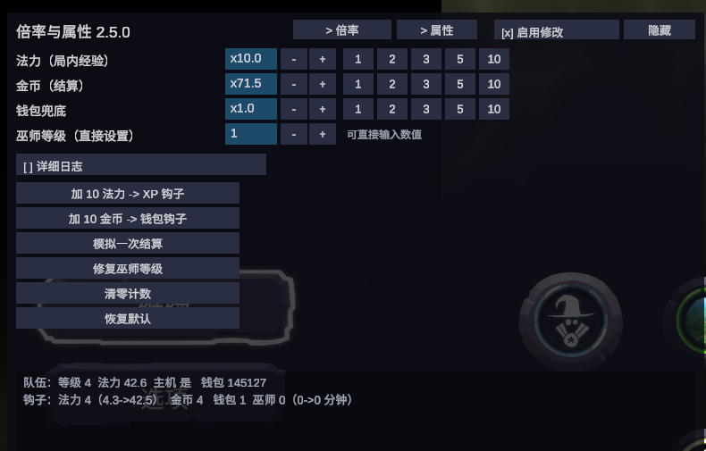
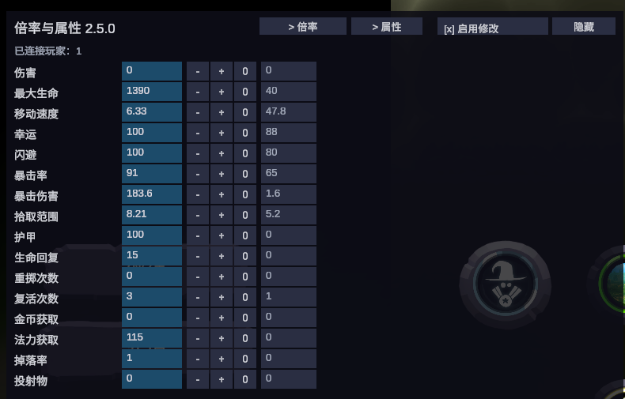
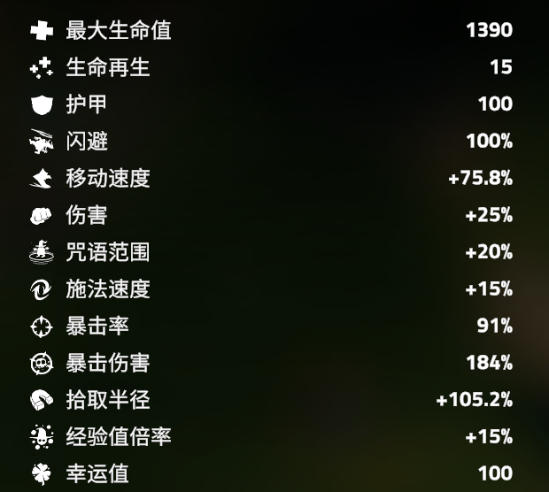

# Spell Brigade — Gain Multipliers / Stat Editor

[中文](README.md) | **English**

A [MelonLoader](https://melonloader.co/) mod for *The Spell Brigade*: in-run mana (XP) multiplier, run-reward gold multiplier, player stat editing, and direct editing of the out-of-run wizard rank. Comes with an in-game panel (uGUI + TextMeshPro, Chinese/English).

- Game version: 1.2.0.20127 (IL2CPP, Unity 6)
- Requires: MelonLoader 0.7.x
- License: MIT

## Preview

| Multipliers page | Stats page |
|---|---|
|  |  |

Stat bonuses show up in **the game's own stat panel** — below, `Max Health 1390` = base 1350 + 40 from the panel (player name cropped out):


## Install

### Option 1: double-click installer (recommended)

1. Extract the zip anywhere (do not run it from inside the archive);
2. Double-click `安装.bat` ("install");
3. The installer finds the game through the Steam registry key / `libraryfolders.vdf` and copies the DLL into `Mods\`.
   If it cannot find the game it asks you to paste the folder path (the one containing `TheSpellBrigade.exe`);
4. If the game lives under `Program Files`, the script requests administrator rights automatically.

### Option 2: manual

Copy `Mods\SpellBrigadeGainMultipliers.dll` into:

```
<game folder>\Mods\
```

i.e. `<Steam>\steamapps\common\The Spell Brigade\Mods\`.

> MelonLoader must already be installed. A console window on startup is normal.

## Uninstall

- Double-click `卸载.bat` ("uninstall"), or
- Delete `<game folder>\Mods\SpellBrigadeGainMultipliers.dll`.

Your settings stay in `UserData\MelonPreferences.cfg` under `[GainMultipliers]` and are reused after reinstalling.

## Usage

The panel appears in the top-left corner. **F8** shows/hides it; `Hide` collapses it.

### Header

- `> 倍率` / `> 属性` — switch between the two pages;
- `[x] 启用修改` — **master switch**. When unchecked, the multiplier, gold and stat patches do nothing
  (the save-repair clamps stay active). Use it when you just want to play vanilla, without uninstalling.

### Multipliers page

| Setting | What it does |
|---|---|
| **Mana (in-run XP)** | Level-up speed inside a run. Multiplies the argument of `PartyLevelManager.TryAddExperience` |
| **Gold (run reward)** | Gold granted at the end of a run. Scales every component of the `EarnedGold` returned by `RunGoldCalculator.Calculate`, so the reward screen and the wallet agree |
| **Wallet fallback** | Keep at 1.0. Only raise it if the gold multiplier has no effect |
| **Wizard rank (set directly)** | Reads/writes the out-of-run wizard rank (1–10) directly |

> The wizard rank is derived from **minutes played**, and the game's own rank math is not bounds-safe:
> past the maximum it reads out of bounds and stores garbage. That is why this mod **no longer offers a
> wizard-rank multiplier** — the level is set directly instead.

Buttons: `+10 mana` (XP hook), `+10 gold` (wallet hook), `Synthetic run reward` (gold hook),
`Repair wizard rank` (fixes an invalid stored rank), `Reset counters`, `Reset defaults`.

Hold `+`/`-` to repeat (starts after 0.35 s, then every 0.05 s). Click a value box to type a number;
`Enter` applies, `Esc` cancels.

### Stats page

The left column shows the **real in-game value**; the right column is the bonus you add:

```
Damage / Max HP / Move speed / Luck / Dodge / Crit chance / Crit damage / Pickup radius /
Armor / HP regen / Rerolls / Revives / Gold gain / Mana gain / Drop chance / Projectiles
```

Each bonus is applied as our own `StaticStatModifier` on every live `PlayerStats`. The game's
`Stat.GetValue()` re-sums the modifier list, so both the in-game stat panel and the actual effect follow.
Stats only work once a run has started (`No player data yet` is shown otherwise).

## Configuration

`<game folder>\UserData\MelonPreferences.cfg`:

```toml
[GainMultipliers]
Enabled = true
XpMultiplier = 2.0
GoldMultiplier = 2.0
GoldGrantMultiplier = 1.0
Verbose = false
ChineseLabels = true
Stat_Luck = 0.0
Stat_Dodge = 0.0
...
```

Panel changes are coalesced and written at most once per second.

## Implementation notes

| Target | Patch |
|---|---|
| `PartyLevelManager.TryAddExperience(float)` | Prefix edits the argument (mana multiplier) |
| `RunGoldCalculator.Calculate(...)` | Postfix scales every `EarnedGold` component |
| `LocalPlayer.AddGold(int)` | Prefix (wallet fallback + observation) |
| `CharacterRankProgression.SetRankProgression(int, float)` | Prefix clamps invalid rank/progress so saves cannot be corrupted |
| `CharacterBadgeDisplay.Show(int, int)` | Prefix clamps the badge index plus a Finalizer, so bad data cannot freeze the menu |

- **No double application**: MelonLoader already auto-patches every `[HarmonyPatch]` class, so the mod does
  not call `PatchAll`. Every prefix/postfix uses a `[ThreadStatic]` nesting guard and only acts on the
  outermost call.
- **Panel**: IMGUI in this build has neither a CJK font (dynamic font API is stripped) nor working button
  events, so the panel is rendered with uGUI + TextMeshPro using the game's own TMP fonts; clicks are
  handled by polling the mouse and hit-testing our own rects.

## Building from source

```powershell
cd SpellBrigadeGainMultipliers
pwsh -File .\build.ps1     # -> out\SpellBrigadeGainMultipliers.dll
pwsh -File .\package.ps1   # -> dist\SpellBrigadeGainMultipliers-<version>.zip
```

The build does not use MSBuild: there is no .NET 6 targeting pack, so `csc.dll` from the SDK compiles
against the game's own .NET 6 runtime (`<game folder>\dotnet`), `MelonLoader\net6` and
`Il2CppAssemblies\*.dll`. Sources are copied to an ASCII path under `%TEMP%` first, because csc cannot
handle non-ASCII paths.

Building therefore requires an actual game installation — CI cannot do it.

## Known limitations

- Mana/gold multipliers only take effect in single player or when you are the host (server-authoritative).
- In co-op these are one-sided changes; tell your teammates first.
- After a game update the IL2CPP proxies change; method names may need to be re-checked.


